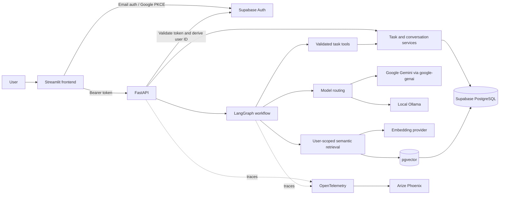

# TaskFlow

TaskFlow is a task manager with a conversational AI assistant. It combines a
Streamlit workspace with a FastAPI backend, Supabase authentication, and
PostgreSQL-backed task and conversation data.

## Project overview

TaskFlow helps an individual organize work, keep track of deadlines, and update
tasks through a normal conversation. The assistant can use validated task tools
to list, create, inspect, update, complete, and delete the signed-in user's
tasks. Semantic retrieval can find related tasks when exact wording is not
known.

## Features

- Create, view, edit, complete, and delete tasks.
- Track task status, priority, and due date.
- Search and filter tasks from the Streamlit workspace.
- Ask the AI assistant to find or manage tasks.
- Validate model-generated tool arguments and enforce task ownership in backend
  services.
- Retrieve semantically related tasks using embeddings and pgvector.
- Save chat history per authenticated account.
- Authenticate with Supabase email/password or optional Google sign-in.
- Trace API, model, embedding, retrieval, and tool execution with OpenTelemetry
  and Arize Phoenix.

## Architecture



The frontend sends a Supabase access token to FastAPI. The backend validates
that token with Supabase Auth and uses the returned user identity for all task,
conversation, and retrieval queries. Clients and AI tools cannot set the owner
ID. The agent selects a configured model, validates any tool arguments, then
calls the same user-scoped service functions used by the task API.

Task embeddings are stored in PostgreSQL using pgvector. Similarity queries
filter on the authenticated user's ID before task records are loaded. Embeddings
must be regenerated if the embedding provider or model changes.

OpenTelemetry records request, model, embedding, retrieval, and tool spans.
When configured, the OTLP exporter sends spans to Phoenix. Prompts, task text,
access tokens, and provider keys are not deliberately added to span attributes.

## Technology stack

| Technology | Purpose |
| --- | --- |
| Python 3.11+ | Application runtime |
| FastAPI and Uvicorn | Authenticated REST API |
| Streamlit | Dashboard, task management, and chat UI |
| Supabase Auth | Email/password and optional Google identity |
| PostgreSQL and pgvector | Durable task, conversation, message, and vector storage |
| SQLAlchemy and Alembic | ORM sessions and schema migrations |
| LangGraph | Bounded assistant/tool workflow |
| Google GenAI SDK | Native Gemini calls and function calling |
| Ollama and OpenAI client | Local model endpoint support |
| OpenTelemetry and Arize Phoenix | Tracing and AI workflow inspection |
| Ragas | Retrieval and answer evaluation workflow |
| Pytest, HTTPX, and Ruff | Tests and code quality checks |
| Docker and GitHub Actions | Container build and CI checks |

## Project structure

```text
app/
  agent/          LangGraph state, tools, and workflow
  api/            FastAPI task, chat, and Google sign-in routes
  core/           Settings, auth, logging, rate limits, and telemetry
  evaluation/     Ragas dataset, retrieval, answer generation, and metrics
  services/       Task, conversation, model, and vector services
migrations/       Alembic schema history
tests/            API, auth, agent, routing, reliability, and vector tests
ui/               Streamlit application
docs/             Local operations and provider setup
main.py           FastAPI application entry point
run_evaluation.py Ragas evaluation entry point
```

## Getting started

### Prerequisites

- Python 3.11 or newer and `uv`.
- A Supabase project with Auth enabled and a PostgreSQL connection string.
- Either a Gemini API key or a running Ollama instance with a chat model and an
  embedding model installed.

### Install and configure

```powershell
git clone <repository-url>
cd TaskFlow
Copy-Item .env.example .env
uv sync --all-groups
```

Set the values listed in the next section. Before running migrations, confirm
that `DATABASE_URL` points to the intended development database. Then run:

```powershell
uv run alembic upgrade head
```

To use local Ollama, start Ollama and pull the configured models, for example:

```powershell
ollama pull qwen2.5:3b
ollama pull nomic-embed-text
```

### Start the application

Start the backend:

```powershell
uv run uvicorn main:app --reload
```

Start Streamlit in another terminal:

```powershell
uv run streamlit run ui/streamlit_app.py
```

Open `http://localhost:8501` for TaskFlow, `http://localhost:8000/docs` for the
API reference, and `http://localhost:8000/health` for the backend/database
health check.

## Environment variables

Use the [`.env.example`](.env.example) file as the template. It contains
placeholders only.

| Variable | Purpose |
| --- | --- |
| `DATABASE_URL` | PostgreSQL connection used by FastAPI and Alembic |
| `SUPABASE_URL` | Supabase project URL used by the backend and frontend |
| `SUPABASE_ANON_KEY` | Public Supabase Auth client key; never use a service-role key here |
| `TASKFLOW_API_URL` | FastAPI base URL used by Streamlit; defaults to local port 8000 |
| `AI_PROVIDER` | Default chat and embedding provider: `ollama` or `gemini` |
| `AI_CHAT_PROVIDER` | Optional chat provider override |
| `AI_EMBEDDING_PROVIDER` | Optional embedding provider override |
| `AI_FALLBACK_PROVIDER` | Optional provider for transient failure fallback |
| `OLLAMA_BASE_URL` | OpenAI-compatible local Ollama endpoint |
| `OLLAMA_MODEL` | Ollama chat model name |
| `OLLAMA_EMBEDDING_MODEL` | Ollama embedding model name |
| `GEMINI_API_KEY` | Backend-only Gemini credential |
| `GEMINI_MODEL` | Gemini chat model name |
| `GEMINI_EMBEDDING_MODEL` | Gemini embedding model name |
| `AI_TIMEOUT_SECONDS` | External model request timeout |
| `AI_RETRY_ATTEMPTS` | Maximum attempts for retryable provider failures |
| `AI_RETRY_BASE_SECONDS` | Exponential retry delay base |
| `AI_EMBEDDING_CACHE_TTL_SECONDS` | In-memory embedding cache expiration |
| `AI_EMBEDDING_CACHE_MAX_ENTRIES` | Maximum in-memory cache entries |
| `SUPABASE_GOOGLE_SIGNIN_ENABLED` | Enables the optional Google sign-in route |
| `GOOGLE_SIGNIN_REDIRECT_URI` | Frontend callback origin for Google sign-in |
| `PHOENIX_ENDPOINT` | Optional Phoenix host; exporter appends `/v1/traces` |
| `PHOENIX_API_KEY` | Optional key for a protected Phoenix endpoint |
| `CORS_ORIGINS` | Comma-separated frontend origins allowed by FastAPI |

The database URL, Gemini key, and any Phoenix key belong only in backend
configuration. Streamlit needs the Supabase URL and public anon key to support
email authentication, plus `TASKFLOW_API_URL`.

## Testing and code quality

```powershell
uv run pytest -q
uv run ruff check .
```

Tests cover task CRUD and cross-user access, Supabase token validation, chat
conversation ownership, model tool argument validation, model routing, retries,
embedding cache isolation/invalidation, and user-scoped vector retrieval. The
suite mocks external providers and does not verify live Gemini, Supabase, or
Google OAuth credentials.

Ragas evaluation is a separate workflow:

```powershell
$env:TASKFLOW_EVAL_USER_ID = "<development-user-id>"
uv run python run_evaluation.py
```

It requires a development account with suitable tasks, PostgreSQL/pgvector, and
a configured model provider. It is not part of the test suite.

## Observability

Start Phoenix locally in one terminal:

```powershell
uv run phoenix serve
```

Set the backend environment variable and start FastAPI in another terminal:

```powershell
$env:PHOENIX_ENDPOINT = "http://localhost:6006"
uv run uvicorn main:app --reload
```

Open the Phoenix dashboard at `http://localhost:6006`. OTLP traces are sent to
`http://localhost:6006/v1/traces`. Inspect the `taskflow` project for API,
provider, embedding, retrieval, retry, and tool spans. This local setup and a
SQLite-backed API health request were verified during development.

## Deployment

The repository is configured for a FastAPI backend on Render and a Streamlit
frontend on Streamlit Community Cloud, with Supabase PostgreSQL/Auth as shared
managed services. These hosting targets are not deployed or verified here.

For Render, set backend database, Supabase, provider, CORS, and optional Phoenix
variables. The Docker entry point applies Alembic migrations before Uvicorn
starts; point it at the intended database and review migrations before deploy.
For Streamlit Community Cloud, set `TASKFLOW_API_URL`, `SUPABASE_URL`, and
`SUPABASE_ANON_KEY` in the app's secrets. Add the frontend origin to backend
`CORS_ORIGINS`.

## Security considerations

- FastAPI validates Supabase bearer tokens and derives the owner ID from the
  verified user response.
- Task, conversation, and vector service queries filter by that owner. The
  PostgreSQL migration also configures row-level security policies for user data.
- Model-generated tool arguments are validated against Pydantic schemas; tools
  call application services and do not execute arbitrary SQL.
- Keep Supabase service-role credentials, Gemini keys, and database passwords
  out of Streamlit configuration and Git.
- OAuth state is short-lived and consumed once during Google sign-in.
- Provider logging and tracing retain operational errors and latency without
  intentionally recording prompts, private task text, or credentials.

## Future improvements

- Add disposable PostgreSQL/pgvector integration tests to CI.
- Add backend task-count and server-side search endpoints if client-side
  pagination needs to scale beyond a personal workspace.
- Add a documented recovery flow for expired Supabase sessions.
