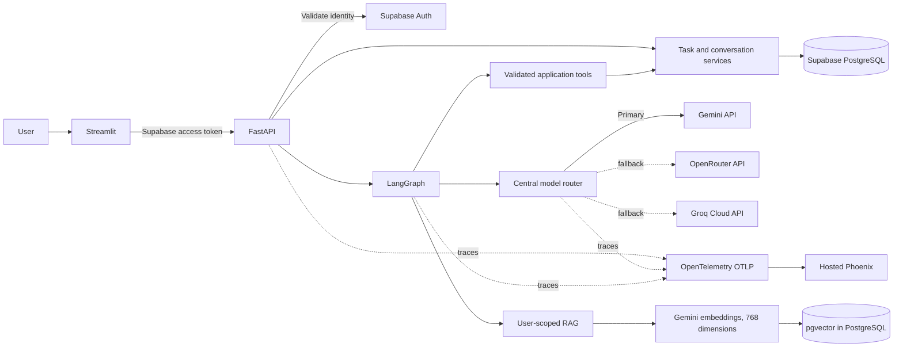

# TaskFlow

TaskFlow is a cloud-oriented task manager with an AI assistant. It combines a
Streamlit interface, FastAPI services, Supabase Auth and PostgreSQL, pgvector
retrieval, and a LangGraph tool workflow. Gemini is the default model provider;
OpenRouter and Groq are configurable alternatives with bounded fallback.

## Features

- Authenticated, user-scoped task creation, search, editing, completion, and deletion.
- Persistent conversations, chronological messages, rename and delete controls.
- Validated AI task tools and semantic retrieval over Gemini embeddings in pgvector.
- Central model routing, bounded retries, provider failover, timeouts, and cooldowns.
- OpenTelemetry traces that can be exported to a separately hosted Phoenix instance.
- Alembic migrations, Docker deployment configuration, and pytest/Ruff CI.

## Architecture



The backend validates the Supabase bearer token and derives the owner ID. Every
task, conversation, message, and semantic search is scoped to that identity.
LangGraph asks the router for model output, then executes validated tools in a
separate node. Provider retries and fallback only wrap model generation; a
fallback response does not re-enter the previous tool node. The selected
provider stays attached to the workflow after a fallback so a later agent turn
does not restart with the failed primary.

The previous conversation issue came from persisting the user message before
generation completed and relying on Streamlit session state for the immediate
view. A failure could leave half a turn. The API now commits user and assistant
messages together only after success; the database transcript is reloaded when
opening a conversation and is the source of display/history context. LangGraph
is invoked with that conversation's recent message history on each request; no
separate checkpoint store is used.

PostgreSQL is the source of truth. Gemini `gemini-embedding-001` vectors remain
768-dimensional; switching embedding model requires a deliberate re-embedding
plan. The pgvector HNSW cosine index supports the existing similarity query.

## Providers and routing

`DEFAULT_AI_PROVIDER=gemini`. `AI_CHAT_PROVIDER` may explicitly select
`gemini`, `openrouter`, or `groq`; `AI_COMPLEX_PROVIDER` and
`AI_IMPORTANT_PROVIDER` optionally select a provider for classified requests.
The built-in classifier is deliberately small and can be adjusted in
`app/services/model_router.py`. `AI_FALLBACK_PROVIDERS` sets candidate order;
remaining configured providers are considered after those preferences.

The configured alternatives are `google/gemma-4-31b-it:free` on OpenRouter and
`qwen/qwen3.8-27b` on Groq. Provider support is checked against current vendor
catalogues and documented in [operations](docs/OPERATIONS.md). Groq currently
labels Qwen 3.8 27B as Preview. No provider's credentials or availability have
been exercised by the unit-test suite. Missing credentials and permanent model
errors do not trigger repeated requests; transient throttles, 5xx responses,
connection errors, and timeouts have bounded retry/fallback handling.

## Technology

| Layer | Technology |
| --- | --- |
| Frontend | Streamlit |
| API and server | FastAPI, Uvicorn |
| Identity | Supabase Auth email/password |
| Database | Supabase PostgreSQL, SQLAlchemy, Alembic |
| Vector search | pgvector, Gemini embeddings |
| Agent | LangGraph, Pydantic-validated tools |
| Models | Gemini, OpenRouter, Groq Cloud |
| Tracing | OpenTelemetry OTLP/HTTP, Arize Phoenix |
| Evaluation | Ragas (development group) |
| Quality | Pytest, HTTPX, Ruff, GitHub Actions |
| Deployment | Docker on Render; Streamlit Community Cloud |

## Project structure

```text
app/agent/       LangGraph state, workflow, and task tools
app/api/         FastAPI task and chat routes
app/core/        Settings, authentication, logging, rate limits, telemetry
app/evaluation/  Ragas datasets and evaluation pipeline
app/services/    Tasks, conversations, provider routing, LLM, vectors
migrations/      Alembic schema history
tests/           Unit and API tests with provider mocks
ui/              Streamlit application entry point
docs/            Operations, provider, and deployment notes
main.py          FastAPI app
Dockerfile       Render-compatible backend container
render.yaml      Render service blueprint (manual deploy)
requirements.txt Streamlit Community Cloud frontend dependencies
```

## Local development

Requirements: Python 3.11+, `uv`, a Supabase project, and a PostgreSQL database
with the pgvector extension for semantic search. AI calls use cloud APIs; TaskFlow
does not run local model inference.

```powershell
Copy-Item .env.example .env
Copy-Item .env.frontend.example .env.frontend
uv sync --all-groups
```

Set backend values in `.env` and the API URL/public Supabase values in
`.env.frontend`. Streamlit reads only `.env.frontend`; backend database and AI
provider secrets stay in `.env`. Point `DATABASE_URL` at a development database,
then apply migrations:

```powershell
uv run alembic upgrade head
```

Run API and UI in separate terminals:

```powershell
uv run uvicorn main:app --reload
uv run streamlit run ui/streamlit_app.py
```

Open `http://localhost:8501`; API docs are at `http://localhost:8000/docs` and
the database health check is `http://localhost:8000/health`. In production,
`APP_ENVIRONMENT=production` rejects SQLite so the API cannot silently rely on
ephemeral local storage.

## Environment variables

Copy `.env.example`; never commit `.env`. Set provider and database secrets on
the backend only. Streamlit receives only the API URL and public Supabase Auth
project values.

| Variable | Used by | Purpose |
| --- | --- | --- |
| `DATABASE_URL` | Backend | PostgreSQL/pgvector connection string with TLS |
| `DATABASE_POOL_SIZE`, `DATABASE_MAX_OVERFLOW` | Backend | SQLAlchemy pool limits |
| `SUPABASE_URL`, `SUPABASE_ANON_KEY` | Backend and UI | Validate sessions and use email/password Auth |
| `DEFAULT_AI_PROVIDER` | Backend | Defaults to `gemini` |
| `AI_CHAT_PROVIDER` | Backend | Optional provider override for chat |
| `AI_COMPLEX_PROVIDER`, `AI_IMPORTANT_PROVIDER` | Backend | Optional task classification preferences |
| `AI_FALLBACK_PROVIDERS` | Backend | Ordered candidates, default `openrouter,groq` |
| `GEMINI_API_KEY`, `GEMINI_MODEL` | Backend | Primary model credentials and chat model |
| `GEMINI_EMBEDDING_MODEL` | Backend | Existing 768-dimension vector model |
| `OPENROUTER_API_KEY`, `OPENROUTER_MODEL` | Backend | OpenRouter alternative |
| `GROQ_API_KEY`, `GROQ_MODEL` | Backend | Groq alternative |
| `AI_TIMEOUT_SECONDS`, `AI_RETRY_ATTEMPTS`, `AI_RETRY_BASE_SECONDS` | Backend | Request and bounded retry behavior |
| `AI_FAILURE_THRESHOLD`, `AI_COOLDOWN_SECONDS` | Backend | In-process provider cooldown |
| `PHOENIX_ENDPOINT`, `PHOENIX_API_KEY` | Backend | Optional hosted Phoenix OTLP endpoint and auth |
| `CORS_ORIGINS` | Backend | Comma-separated allowed frontend origins |
| `TASKFLOW_API_URL` | UI | FastAPI URL; set the deployed Render URL in Cloud |

## Database, authentication, and security

Supabase Auth email/password remains the only account sign-in method. FastAPI
validates access tokens with Supabase Auth. Service queries derive the user ID
from that validated identity, never from a client-supplied owner field. The
Alembic schema enables RLS for user records and creates pgvector storage and
indexes. The app also enforces ownership in its SQLAlchemy service layer.

Migration `0003` drops only `oauth_states`, a short-lived PKCE table used by
retired Google sign-in; it does not drop tasks, conversations, messages, or
migration `0004` adds message-order and vector-search indexes; `0005` adds a
conversation activity timestamp and owner/activity index. Review
migrations against the target database before running them. No production
database was accessed or modified during this work.

Task tools accept Pydantic-validated arguments and call application services;
the agent has no arbitrary SQL tool. Keep database passwords, service-role keys,
and AI provider keys out of Streamlit secrets and source control. The frontend
uses only the public Supabase anon/publishable key.

## Tests and code quality

```powershell
uv run pytest -q
uv run ruff check .
uv run ruff format --check .
```

Tests use mocked model calls. They cover authenticated task operations,
ownership, conversation controls, provider selection/retries/fallback, tool
argument validation, embedding cache isolation, and vector-query scoping. Live
provider, Supabase, database, and Phoenix service calls require separate
credentials and are not claimed as verified by unit tests.

Ragas evaluation is an opt-in development workflow; it requires a configured
provider and a development Supabase/PostgreSQL dataset. Do not run it against
production data without explicit review.

## Phoenix observability

Set `PHOENIX_ENDPOINT` to the HTTPS OTLP/HTTP base URL for a hosted or separately
deployed Phoenix receiver. TaskFlow appends `/v1/traces` unless that path is
already present. If the receiver requires authentication, set
`PHOENIX_API_KEY`. Configure the matching receiver URL and key in the Phoenix
host's deployment settings. Phoenix can then display incoming FastAPI requests,
model/provider attempts, fallback decisions, LangGraph nodes, tools, embeddings,
retrieval, latency, and errors. TaskFlow avoids recording prompts, secrets, and
access tokens as trace attributes. Trace export is optional and failure does not
prevent API startup. Trace delivery has not been verified without a hosted
Phoenix endpoint and credentials.

## Deployment

No service is deployed from this workspace. See [deployment and operations](docs/OPERATIONS.md)
for exact manual setup.

- **Render backend:** use the `render.yaml` blueprint or configure the Docker
  web service manually. Set the environment values in Render; the container
  binds `0.0.0.0:$PORT`, applies Alembic migrations, and exposes `/health`.
  `autoDeploy` is disabled in the blueprint.
- **Streamlit Community Cloud:** deploy `ui/streamlit_app.py`. Configure
  `TASKFLOW_API_URL`, `SUPABASE_URL`, and `SUPABASE_ANON_KEY` in its Secrets page.
  Set `TASKFLOW_API_URL` to the public Render API URL, never `localhost`.
- **Supabase:** use the PostgreSQL pooler URL with TLS, enable pgvector, and
  configure Auth email/password settings and allowed frontend URLs.
- **CORS:** set `CORS_ORIGINS` on Render to the exact Streamlit app origin(s).

## Future work

- Run PostgreSQL/pgvector integration tests in CI with a disposable service.
- Add durable shared circuit-breaker state if deploying multiple API instances.
- Measure production UI/API request counts before introducing caching.
- Verify end-to-end provider fallback, Phoenix delivery, and hosted auth after
  deployment credentials are configured.
